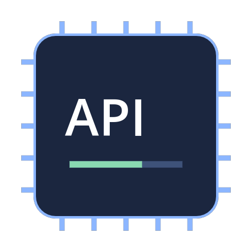
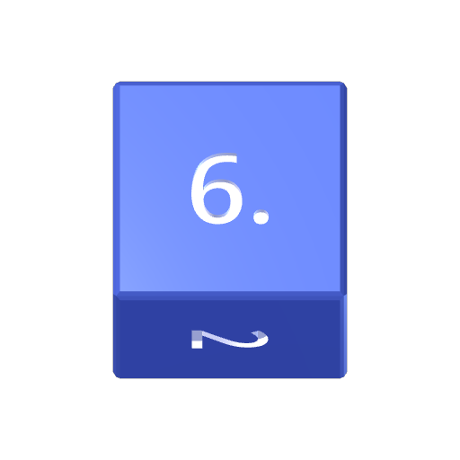
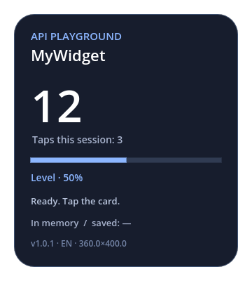
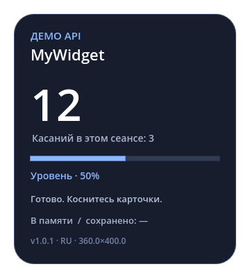
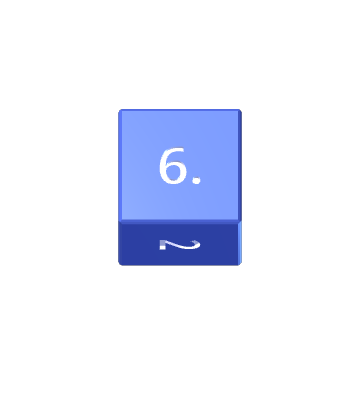
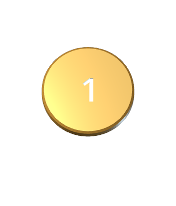
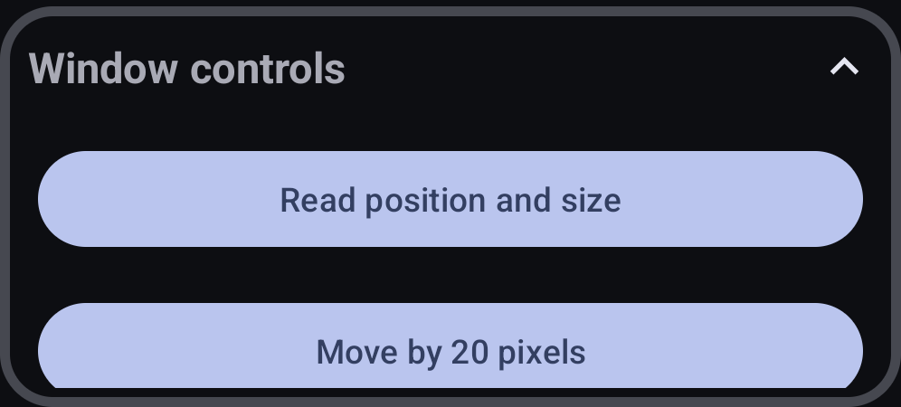
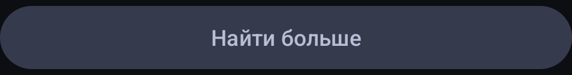

# MyWidget library

[Русская версия](README.ru.md)

Installable widgets and working Godot examples for MyWidget. Installation packages are in [`downloads/`](downloads/). Godot projects are in [`sources/`](sources/); you do not need them to install a widget.

| Widget | Download | What it does |
| --- | --- | --- |
| API Demo 1.0.0 | [Install ZIP](downloads/demo-1.0.0.zip?raw=true) | Menus, session memory, saved JSON, RU/EN, media, notifications, window controls, and shutdown |
| Dice 1.1.2 | [Install ZIP](downloads/dice-1.1.2.zip?raw=true) | d2 coin and d4/d6/d8/d10/d12/d20/d100; engraved numbers, beveled edges, animated rolls |

 

## Install a widget

1. Download an **Install ZIP** from the table. Do not use GitHub's **Code → Download ZIP**: that downloads this entire source repository.
2. In MyWidget, open **Settings → Installation** and enable **Installation from external sources**. Read the explanation shown by the app.
3. Open **Library**, press **+**, and select the downloaded ZIP. Keep the archive intact; do not extract it first.
4. Check the name/version in the installation dialog and install it. Select the widget in Library, then press Play. Grant the overlay permission if Android asks.
5. Return to Home to change its controls. Drag the overlay to move it; use the app's scale control to resize it. Stop it from the app or notification.

**Find more** in the Android app opens this repository. A package contains `meta.json`, a root PCK, and its images. It is not an APK. Imported widgets run code, so install packages from authors you trust. Removing Dice from the app's prepack does not delete an already installed copy.

## Screenshots

These are renders of the actual demo scene, using its Russian and English interfaces.

 

 

Native Android window controls and the library button:





## Start with the demo

Open [`sources/demo/project.godot`](sources/demo/project.godot) in **Godot 4.5.2**. The card also runs on desktop without the Android plugin. Android-specific buttons then explain that they require MyWidget; they do not pretend to resize a desktop window.

Tap the card or choose **Increment counter**. The large number changes, along with **Taps this session**. The first belongs to the state dictionary; the session metric is a normal GDScript variable that resets on a new process.

Open **Persistent storage → Save JSON**, increment again, then choose **Restore JSON**. The large number returns to its saved value, while the session metric stays unchanged. **Save each change** enables automatic saving. **Delete saved state and reset** removes the saved key and restores defaults.

The demo also saves before a graceful shutdown, even with automatic saving disabled. Stopping normally therefore preserves the latest state. Killing the renderer or crashing is not the same as receiving the shutdown signal.

## Files and build

```text
downloads/             Ready-to-install ZIP packages, separate from source
sources/demo/          Small, readable API example and tests
sources/dice/          3D dice project, baked meshes, tests, and mesh baker
manifests/             External meta.json files used for installation
assets/                Transparent avatars and banners
docs/screenshots/      Scene renders and Android screenshots
catalog.json           Download URLs, versions, sizes, SHA-256 hashes
tools/build.ps1        Repeatable tests, renders, PCK exports, and ZIP creation
```

On Windows with PowerShell and Godot 4.5.2:

```powershell
./tools/build.ps1 -Godot 'C:/Tools/Godot/Godot_v4.5.2-stable_win64_console.exe'
# Build one project:
./tools/build.ps1 -Widget demo -Godot 'C:/Tools/Godot/Godot_v4.5.2-stable_win64_console.exe'
# Rebuild Dice's engraved meshes as well:
./tools/build.ps1 -Widget dice -RebakeDice -Godot 'C:/Tools/Godot/Godot_v4.5.2-stable_win64_console.exe'
```

You can also set `GODOT_BIN`. The script runs tests, renders assets/screenshots, exports the Android PCK, opens the exported package for a smoke check, creates installation ZIPs, and refreshes `catalog.json`. Rendering images requires a graphical session. Build output and Godot caches are excluded from Git.

## Connecting to MyGodotPlugin

[`main.gd`](sources/demo/main.gd) checks the singleton before calling Android functions:

```gdscript
if Engine.has_singleton("MyGodotPlugin"):
    plugin = Engine.get_singleton("MyGodotPlugin")
    plugin.on_widget_control_changed.connect(_on_control)
    plugin.on_locale_changed.connect(_on_locale)
    plugin.on_graceful_end.connect(_on_end)
```

`setPluginSignals()` prints the plugin's available signals for debugging; it does not register new signals.

### Menus

`populateScrollViewFromJSONString(JSON.stringify(items))` replaces the widget's native Android menu. `build_menu()` in the demo contains every supported control type:

| `type` | Fields and behavior |
| --- | --- |
| `text` | `text`: label |
| `divider` | Section separator |
| `group` | `text`, `items`: collapsible group, including nested controls |
| `button` | `name`, `text`: sends a click event |
| `edittext` | `name`, `text`, string `value` |
| `switch`, `checkbox` | `name`, `text`, boolean `value` |
| `spinner` | `name`, `values`, integer `value`: **zero-based index**, not the displayed text |
| `seekbar` | `name`, `text`, `min`, `max`, `step`, integer `value` |
| `progress` | `name`, `max`, `value`: display-only progress indicator |
| `mediapicker` | `name`, `text`, `filetypes`, for example `image/*` |

```gdscript
var items = [
    {"type": "text", "text": "Settings"},
    {"type": "switch", "name": "mywidget_enabled", "text": "Enabled", "value": true},
    {"type": "seekbar", "name": "mywidget_level", "min": 0, "max": 100, "step": 5, "value": 50}
]
plugin.populateScrollViewFromJSONString(JSON.stringify(items))
```

Events arrive as `on_widget_control_changed(name, id, type, value)`. All four arguments are strings. A boolean is `"true"` or `"false"`; numeric values must be converted with `to_int()`. The optional JSON `id` defaults to `name`; the demo's increment button shows a separate ID.

Use `updateControlValue(name, string_value)` to change an existing control from Godot without rebuilding the whole form. Publish its schema first so Android knows the value's type. This avoids resetting text cursors while editing. The demo updates the progress bar when its slider changes and changes multiple controls from the **Change controls from Godot** button.

`getWidgetControlValueByName(name)` returns a string or null. `getWidgetControlValues()` returns an Android-backed map; the demo logs it for inspection rather than assuming it is a GDScript Dictionary. Control persistence currently belongs to the host and uses shared names, so prefix your controls (`demo_`, `dice_`, or your own namespace). Keep widget-owned state in `saveWidgetData` instead of relying on control names alone.

### RAM and persistent data

[`state.gd`](sources/demo/state.gd) defines defaults, validates loaded values, bounds the counter, normalizes slider steps, and converts an Android `JSONObject` wrapper through `toString()` before JSON parsing.

```gdscript
plugin.saveWidgetData("api_demo_state_v1", JSON.stringify(state))
state = State.decode(plugin.getWidgetData("api_demo_state_v1"))
plugin.delWidgetData("api_demo_state_v1")
```

The plugin writes strings into the active widget's private SharedPreferences namespace. This survives renderer restarts. A GDScript variable such as `session_taps` is RAM-only. `saved_snapshot` in the demo mirrors the last save for display; it is not a second persistent database. Use your own versioned key and migrate old values when the schema changes. Saving a string is not a promise of synchronous crash-safe disk durability.

### Localization

`getLocale()` returns the application locale, such as `ru-RU` or `en-US`. `on_locale_changed(tag)` also fires when the Android UI requests the current menu after recreation. The demo follows the app by default, normalizes Russian tags with `begins_with("ru")`, uses English for other languages, and offers a manual RU/EN override. It rebuilds menu captions while preserving state. Install-card names come from `meta.json.name`, independently of the scene's text.

### Images and notifications

The image picker sends a file path after Android copies the selected content into the widget's directory. The demo loads that path with `Image.load()` and stores it in its JSON. It clears an unavailable image rather than failing at startup. The host can fall back to a `content://` URI when copying fails; `Image.load()` does not decode such a URI directly.

`updateNotificationText(text)` updates the ongoing notification. `updateNotificationImageFromWidget("banner.png")` resolves a path relative to the installed widget. `updateNotificationImageFromPath(path)` accepts an image inside that widget's directory; arbitrary external paths are not supported. The demo shows both image APIs.

### Window and input

| API | Demo use |
| --- | --- |
| `getWidgetX()`, `getWidgetY()` | Read overlay position |
| `getWidgetW()`, `getWidgetH()` | Read current physical window size |
| `getWindowPosition()` | Read/log the Android position map |
| `changeWidgetPosition(x, y)` | Move by 20 pixels |
| `changeWidgetSize(w, h)` | Restore dimensions from the metadata snapshot |
| `makeFullscreen()`, `exitFullscreen()` | Enter and leave fullscreen from native menu buttons |
| `makeClickPassthrough(bool)` | Despite the name, **true enables** the widget's custom touch region; false clears/disables it |
| `setViewRegion(x, y, w, h)` | Define the touchable area in physical surface pixels |
| `refreshRenderView()` | Request a surface refresh |

The demo converts canvas coordinates using actual window and logical viewport sizes. It updates a small fixed rectangle on a timer, without reading back the framebuffer every frame. The pass-through example restores touch input after three seconds. A user can still disable widget interaction through the app.

The host emits `on_window_moving(vx, vy)` during movement and `on_window_moving_ended()` on **every ACTION_UP**, including a stationary tap. Track whether movement occurred before treating the latter as a drag completion. The demo rejects drags and long presses as counter taps and ignores synthetic mouse events created from touch input.

### Graceful shutdown and signals

`on_graceful_end()` is the request to save and finish. `gracefulEndNotify(1)` announces preparation, `gracefulEndNotify(0)` completes shutdown, and `gracefulEndNotify(2)` cancels the request. Preparation cancels the host's initial one-second timeout, so always finish the work and send 0. A repeated close request can force termination.

The demo's **Cancel next stop once** checkbox demonstrates status 2. The next regular stop saves and sends 1 → 0. `on_test(String)` is a diagnostic signal exposed by the plugin; ordinary widgets do not have a Godot-callable method to emit it. The other signals are connected in `_ready()`.

## Working with meta.json

[`manifests/demo.json`](manifests/demo.json) is the installation manifest, outside the PCK. The build copies the same data to `sources/demo/metadata.json` and includes that snapshot in the PCK. The demo reads the snapshot with `FileAccess`; the current Android plugin has no live `getMeta()` method. After changing the external manifest, rebuild the PCK to keep the snapshot in sync.

| Field | Meaning |
| --- | --- |
| `magicId` | Stable package identity used to recognize updates |
| `name` | String or language map, for example `{ "en": "API Demo", "ru": "Демо API" }` |
| `version` | Increase when distributing an update; keeping the same version can suppress an automatic bundled update |
| `author`, `description`, `meLink` | Author, short description, optional author URL |
| `created`, `updated` | Informational timestamps |
| `requestedWindowWidth`, `requestedWindowHeight` | Initial Android window dimensions; use positive values, up to 4096; the app's scale multiplier is applied separately |
| `files.pck` | Exported PCK filename; keep the PCK at archive root |
| `files.avatar`, `files.banner`, `files.media` | Relative image paths and gallery images |
| `files.description_md` | Optional Markdown description file |
| `properties` | Additional publisher metadata; not a substitute for plugin permissions or executable APIs |

Use relative paths without traversal. Keep `meta.json` and the PCK at the root of the installation ZIP, not inside an extra directory. The demo does not require native `.so` libraries. Its `properties.engine` records the Godot version used to build it.

## Verification

Demo tests cover Android JSON conversion, corrupted/missing saves, RAM/persistent separation, auto-save, control updates, all menu types, locales, shutdown statuses, and gestures. Dice tests cover 240 rolls, all face orientations, engraving depth, bevel/material surfaces, highlight, and the result popup lifecycle. The build also launches each exported PCK. Android integration installs the demo through the same ZIP reader used by the app.

`catalog.json` is a publication manifest, not an automatic update service. Its SHA-256 values describe the exact ZIP bytes in `downloads/`. The app's current **Find more** button opens this page; it does not silently install or update packages.
