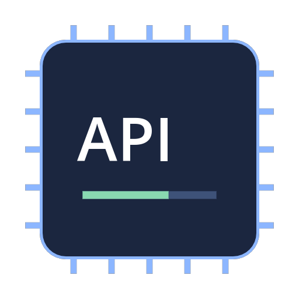
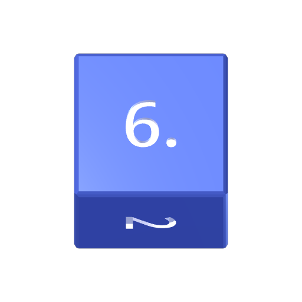
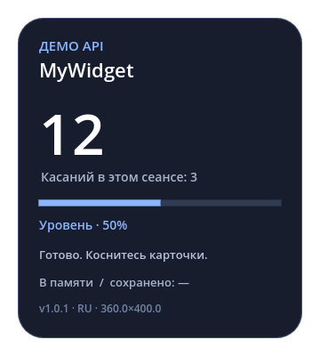
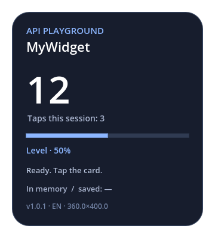
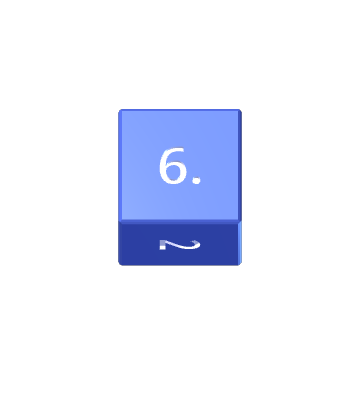
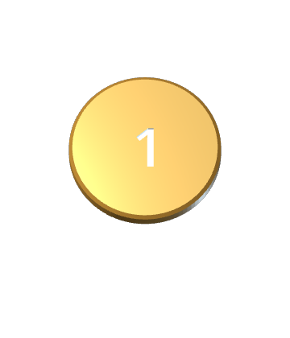

# Библиотека MyWidget

[English version](README.md)

Готовые виджеты и рабочие примеры Godot для MyWidget. Установочные архивы лежат в [`downloads/`](downloads/), исходные проекты — в [`sources/`](sources/). Чтобы установить виджет, исходники не нужны.

| Виджет | Скачать | Возможности |
| --- | --- | --- |
| Демо API 1.0.0 | [Установочный ZIP](downloads/demo-1.0.0.zip?raw=true) | Меню, память сеанса, сохранение JSON, RU/EN, изображения, уведомления, окно и завершение |
| Кость 1.1.2 | [Установочный ZIP](downloads/dice-1.1.2.zip?raw=true) | Монетка d2 и d4/d6/d8/d10/d12/d20/d100; углублённые цифры, фаски и анимация броска |

 

## Установка

1. Скачайте **Установочный ZIP** из таблицы. Кнопка GitHub **Code → Download ZIP** скачивает весь репозиторий с исходниками — это другой архив.
2. В MyWidget откройте **Настройки → Установка**, включите **Установка из внешних источников** и прочитайте пояснение приложения.
3. Перейдите в **Библиотеку**, нажмите **+** и выберите скачанный ZIP. Распаковывать его заранее не нужно.
4. Проверьте название и версию в диалоге установки. Установите виджет, выберите его в библиотеке и нажмите Play. Если Android запросит разрешение на отображение поверх других приложений, выдайте его.
5. Меню виджета находится на главной странице. Оверлей можно перетаскивать, масштаб — менять ползунком приложения. Остановка доступна в приложении и уведомлении.

Кнопка **Найти больше** в приложении открывает этот репозиторий. Пакет содержит `meta.json`, PCK в корне и изображения. Это не APK. Виджеты исполняют код, поэтому устанавливайте пакеты авторов, которым доверяете. Удаление Dice из препака приложения не удаляет уже установленную копию.

## Скриншоты

Это рендеры настоящей сцены демо с русским и английским интерфейсом.

 

 

Скриншоты меню Android добавлены ниже после проверки на устройстве.

## Как пользоваться демо

Откройте [`sources/demo/project.godot`](sources/demo/project.godot) в **Godot 4.5.2**. Карточка работает и на компьютере без Android-плагина. В этом режиме кнопки Android API сообщают, что функция доступна внутри MyWidget, а не имитируют изменение окна компьютера.

Коснитесь карточки или нажмите **Увеличить счётчик** в меню. Изменятся большое число и показатель **Касаний в этом сеансе**. Первое хранится в словаре состояния; второй — в обычной переменной GDScript и сбрасывается при новом запуске процесса.

В группе **Постоянное хранилище** нажмите **Сохранить JSON**, увеличьте число ещё раз и выберите **Восстановить JSON**. Большое число вернётся к сохранённому значению, а счётчик текущего сеанса останется прежним. Переключатель **Сохранять каждое изменение** включает автосохранение. **Удалить сохранение и сбросить** удаляет ключ и возвращает настройки по умолчанию.

Перед штатным завершением демо тоже сохраняет состояние, даже если автосохранение выключено. Поэтому обычная остановка сохраняет последние изменения. Аварийное убийство процесса не равно получению сигнала завершения.

## Структура и сборка

```text
downloads/             ZIP для установки, отдельно от исходников
sources/demo/          Небольшой пример API и его тесты
sources/dice/          3D-кость, запечённые меши, тесты и генератор мешей
manifests/             Внешние meta.json для установки
assets/                Прозрачные аватары и баннеры
docs/screenshots/      Рендеры сцен и скриншоты Android
catalog.json           Ссылки, версии, размеры и SHA-256 архивов
tools/build.ps1        Тесты, рендеры, экспорт PCK и упаковка ZIP
```

Сборка в Windows, PowerShell и Godot 4.5.2:

```powershell
./tools/build.ps1 -Godot 'C:/Tools/Godot/Godot_v4.5.2-stable_win64_console.exe'
# Только демо:
./tools/build.ps1 -Widget demo -Godot 'C:/Tools/Godot/Godot_v4.5.2-stable_win64_console.exe'
# Кость с повторной генерацией углублений и фасок:
./tools/build.ps1 -Widget dice -RebakeDice -Godot 'C:/Tools/Godot/Godot_v4.5.2-stable_win64_console.exe'
```

Путь к Godot можно также передать через `GODOT_BIN`. Скрипт запускает тесты, рендерит изображения, экспортирует Android PCK, запускает готовый PCK для проверки, собирает ZIP и обновляет `catalog.json`. Для рендера изображений нужен графический сеанс. Промежуточные файлы и кеш Godot не попадают в Git.

## Подключение MyGodotPlugin

[`main.gd`](sources/demo/main.gd) сначала проверяет наличие singleton:

```gdscript
if Engine.has_singleton("MyGodotPlugin"):
    plugin = Engine.get_singleton("MyGodotPlugin")
    plugin.on_widget_control_changed.connect(_on_control)
    plugin.on_locale_changed.connect(_on_locale)
    plugin.on_graceful_end.connect(_on_end)
```

`setPluginSignals()` выводит доступные сигналы в лог для диагностики. Этот вызов не регистрирует новые сигналы.

### Создание меню

`populateScrollViewFromJSONString(JSON.stringify(items))` заменяет нативное Android-меню виджета. В `build_menu()` демо есть все поддерживаемые типы:

| `type` | Поля и назначение |
| --- | --- |
| `text` | `text`: подпись |
| `divider` | Разделитель |
| `group` | `text`, `items`: сворачиваемая группа с вложенными элементами |
| `button` | `name`, `text`: событие нажатия |
| `edittext` | `name`, `text`, строковое `value` |
| `switch`, `checkbox` | `name`, `text`, логическое `value` |
| `spinner` | `name`, `values`, целое `value`: **индекс с нуля**, а не показанная строка |
| `seekbar` | `name`, `text`, `min`, `max`, `step`, целое `value` |
| `progress` | `name`, `max`, `value`: индикатор без пользовательского ввода |
| `mediapicker` | `name`, `text`, `filetypes`, например `image/*` |

```gdscript
var items = [
    {"type": "text", "text": "Настройки"},
    {"type": "switch", "name": "mywidget_enabled", "text": "Включено", "value": true},
    {"type": "seekbar", "name": "mywidget_level", "min": 0, "max": 100, "step": 5, "value": 50}
]
plugin.populateScrollViewFromJSONString(JSON.stringify(items))
```

События приходят через `on_widget_control_changed(name, id, type, value)`. Все четыре аргумента — строки. Логическое значение приходит как `"true"` или `"false"`, число нужно преобразовать через `to_int()`. Необязательное поле JSON `id` по умолчанию равно `name`; у кнопки увеличения счётчика показан пример отдельного ID.

`updateControlValue(name, string_value)` меняет существующий элемент из Godot без пересоздания всей формы. Сначала опубликуйте схему элемента, чтобы Android знал его тип. Это позволяет не сбрасывать курсор при вводе текста. В демо ползунок обновляет индикатор прогресса, а кнопка **Изменить значения из Godot** меняет несколько контролов сразу.

`getWidgetControlValueByName(name)` возвращает строку или null. `getWidgetControlValues()` возвращает Android-объект карты; демо выводит его для диагностики, не принимая за обычный Dictionary GDScript. Имена контролов сейчас хранятся в общем пространстве хоста, поэтому используйте префиксы (`demo_`, `dice_` или свои). Собственное состояние виджета сохраняйте через `saveWidgetData`, а не только через контролы.

### Память и сохранения

[`state.gd`](sources/demo/state.gd) задаёт значения по умолчанию, проверяет загруженные данные, ограничивает счётчик и значения ползунка. Обёртка Android `JSONObject` преобразуется через `toString()`, после чего разбирается JSON.

```gdscript
plugin.saveWidgetData("api_demo_state_v1", JSON.stringify(state))
state = State.decode(plugin.getWidgetData("api_demo_state_v1"))
plugin.delWidgetData("api_demo_state_v1")
```

Плагин записывает строки в SharedPreferences активного виджета. Эти данные переживают перезапуск рендерера. Переменная GDScript, например `session_taps`, живёт только в RAM. `saved_snapshot` лишь показывает последнее сохранение на карточке, это не второе постоянное хранилище. Используйте свой ключ с версией и мигрируйте старые данные при изменении формата. Вызов сохранения не обещает синхронную запись на диск, устойчивую к аварийному завершению.

### Локализация

`getLocale()` возвращает язык приложения, например `ru-RU` или `en-US`. `on_locale_changed(tag)` также вызывается при запросе актуального меню после пересоздания Android-интерфейса. По умолчанию демо следует языку приложения, определяет русский через `begins_with("ru")` и использует английский для остальных языков. Есть ручное переключение RU/EN. При смене языка меняются подписи меню, а состояние сохраняется. Название в карточке установки берётся из `meta.json.name` независимо от текста сцены.

### Изображения и уведомления

После выбора изображения Android копирует файл в каталог виджета и передаёт путь. Демо загружает его через `Image.load()` и сохраняет путь в JSON. Если изображение больше недоступно, оно сбрасывается без падения. При неудаче копирования хост может передать `content://` URI; напрямую загрузить такой URI через `Image.load()` нельзя.

`updateNotificationText(text)` обновляет текст постоянного уведомления. `updateNotificationImageFromWidget("banner.png")` разрешает путь относительно установленного пакета. `updateNotificationImageFromPath(path)` принимает изображение внутри каталога этого виджета; произвольные внешние пути не поддерживаются. В демо показаны оба способа обновления изображения.

### Окно и касания

| API | Пример в демо |
| --- | --- |
| `getWidgetX()`, `getWidgetY()` | Чтение позиции оверлея |
| `getWidgetW()`, `getWidgetH()` | Чтение физического размера окна |
| `getWindowPosition()` | Чтение и вывод Android-карты позиции |
| `changeWidgetPosition(x, y)` | Сдвиг на 20 пикселей |
| `changeWidgetSize(w, h)` | Возврат размера из снимка метаданных |
| `makeFullscreen()`, `exitFullscreen()` | Вход и выход из полного экрана кнопками нативного меню |
| `makeClickPassthrough(bool)` | Несмотря на название, **true разрешает** собственную область касаний, false очищает и отключает её |
| `setViewRegion(x, y, w, h)` | Область касаний в физических пикселях поверхности |
| `refreshRenderView()` | Обновление поверхности рендерера |

Демо переводит координаты сцены через фактический размер окна и логического viewport. Небольшая фиксированная область обновляется таймером; читать изображение framebuffer каждый кадр не нужно. Пример пропуска касаний восстанавливает ввод через три секунды. Пользователь по-прежнему может отключить взаимодействие в приложении.

Хост присылает `on_window_moving(vx, vy)` при движении, а `on_window_moving_ended()` — после **каждого ACTION_UP**, даже неподвижного тапа. Сначала проверьте, было ли движение, и только потом считайте это завершением перетаскивания. Демо не увеличивает счётчик от свайпа или долгого нажатия и игнорирует синтетические события мыши от сенсорного ввода.

### Завершение и сигналы

`on_graceful_end()` просит сохранить данные и завершиться. `gracefulEndNotify(1)` сообщает о подготовке, `gracefulEndNotify(0)` завершает остановку, `gracefulEndNotify(2)` отменяет запрос. Статус 1 отключает исходный таймаут хоста в одну секунду, поэтому работу нужно закончить и обязательно отправить 0. Повторная команда закрытия может принудительно завершить процесс.

Флажок **Один раз отменить остановку** показывает статус 2. Следующая обычная остановка сохраняет данные и отправляет 1 → 0. `on_test(String)` — диагностический сигнал плагина; у обычной сцены нет доступного из Godot метода, чтобы его отправить. Остальные сигналы подключены в `_ready()`.

## Работа с meta.json

[`manifests/demo.json`](manifests/demo.json) — установочный манифест снаружи PCK. При сборке те же данные копируются в `sources/demo/metadata.json` и попадают внутрь PCK как снимок. Демо читает его через `FileAccess`: у текущего Android-плагина нет метода `getMeta()` для чтения живого манифеста. После изменения внешней меты пересоберите PCK, чтобы обновить снимок.

| Поле | Назначение |
| --- | --- |
| `magicId` | Постоянный идентификатор пакета для распознавания обновлений |
| `name` | Строка или карта языков, например `{ "en": "API Demo", "ru": "Демо API" }` |
| `version` | Увеличивайте при публикации обновления; прежняя версия может не запустить автоматическое обновление встроенного пакета |
| `author`, `description`, `meLink` | Автор, краткое описание и необязательная ссылка автора |
| `created`, `updated` | Информационные даты |
| `requestedWindowWidth`, `requestedWindowHeight` | Начальный размер Android-окна; положительные значения до 4096; масштаб приложения применяется отдельно |
| `files.pck` | Имя экспортированного PCK; сам файл лежит в корне архива |
| `files.avatar`, `files.banner`, `files.media` | Относительные пути к изображениям и галерее |
| `files.description_md` | Необязательный файл описания Markdown |
| `properties` | Дополнительные данные автора, а не разрешения или новые исполняемые методы API |

Используйте относительные пути без переходов наверх. `meta.json` и PCK должны лежать в корне установочного ZIP, а не в дополнительной папке. Демо не требует нативных библиотек `.so`. `properties.engine` указывает версию Godot, которой собран пакет.

## Проверки

Тесты демо проверяют Android JSON, повреждённые и отсутствующие сохранения, разделение RAM/постоянного состояния, автосохранение, обновление контролов, все типы меню, локали, статусы завершения и жесты. Тесты кости проверяют 240 бросков, ориентацию каждой грани, глубину вырезов, фаски, подсветку и появление/исчезновение результата. Сборка дополнительно запускает каждый экспортированный PCK. На Android демо устанавливается через тот же разборщик ZIP, которым пользуется приложение.

`catalog.json` — манифест публикации, а не автоматический сервис обновлений. SHA-256 рассчитаны по точным байтам архивов из `downloads/`. Текущая кнопка **Найти больше** открывает эту страницу и не устанавливает пакеты без участия пользователя.
